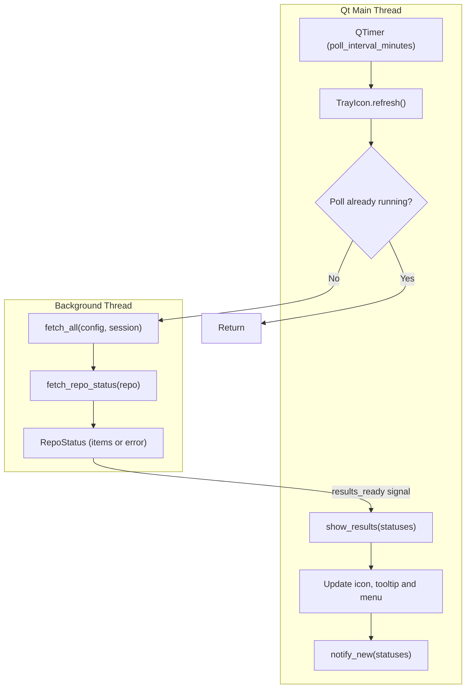

# Architecture & Design

GitHub Monitor is a single-process PyQt6 application. A Qt timer starts a short-lived background thread that queries GitHub; the results travel back to the main thread through a Qt signal, where the icon, tooltip, menu and notifications are updated.

---

## Module Layout

| Module | Responsibility |
| :--- | :--- |
| `__main__.py` | Entry point: loads the configuration, creates `QApplication`, shows the tray icon and triggers the first poll. |
| `config.py` | Reads and validates `~/.config/github-monitor/config.toml` into an immutable `Config`. |
| `github.py` | GraphQL queries, pagination, the attention rule and per-repository error isolation. |
| `tray.py` | `TrayIcon` (`QSystemTrayIcon`): icon rendering, tooltip, menu, polling timer and notifications. |
| `i18n.py` | gettext catalog loading; exposes `_` and `ngettext`. |

---

## Execution Flow

---

## 1. Configuration Loading

`load_config` fails fast: a missing file, a missing required field or a repository that is not in `owner/name` form raises `ConfigError`. `__main__.main` prints it and exits before any Qt object is created, so the message is always visible in the terminal. Maintainer logins are lower-cased once at load time so later comparisons are case-insensitive.

---

## 2. Non-Blocking Polling

All state changes happen on the Qt main thread. Only the network access runs elsewhere:

1. A `QTimer` calls `TrayIcon.refresh()` every `poll_interval_minutes`; the first poll is triggered explicitly at startup, and a left click triggers one on demand.
2. `refresh()` returns immediately if `polling` is set, so slow responses can never pile up concurrent polls.
3. Otherwise it starts a daemon `threading.Thread` that runs `fetch_all` and emits the `results_ready` signal (`pyqtSignal(list)`) with one `RepoStatus` per repository.
4. Being a cross-thread Qt signal, the connected `show_results` slot runs on the main thread, clears `polling` and refreshes the whole UI.

---

## 3. Per-Repository Failure Isolation

`fetch_all` queries repositories one after another and wraps each in a `try/except` for `requests.RequestException` and `GitHubError`. A failing repository becomes `RepoStatus(error=...)` while the rest are still reported, so a typo in one name or a single revoked permission never hides the others. Errors are shown in the tooltip, in the repository's menu and through the red badge.

---

## 4. Data Model

| Type | Fields |
| :--- | :--- |
| `Config` | `token`, `repositories`, `maintainers` (`frozenset`), `poll_interval_minutes` |
| `Item` | `repo`, `kind` (`pr` or `issue`), `number`, `title`, `url` |
| `RepoStatus` | `repo`, `pull_requests`, `issues`, `error`; the `pending` property concatenates pull requests and issues |

All three are frozen dataclasses. The `requests.Session` is passed into `fetch_all`, which keeps the network layer trivially replaceable in tests.
